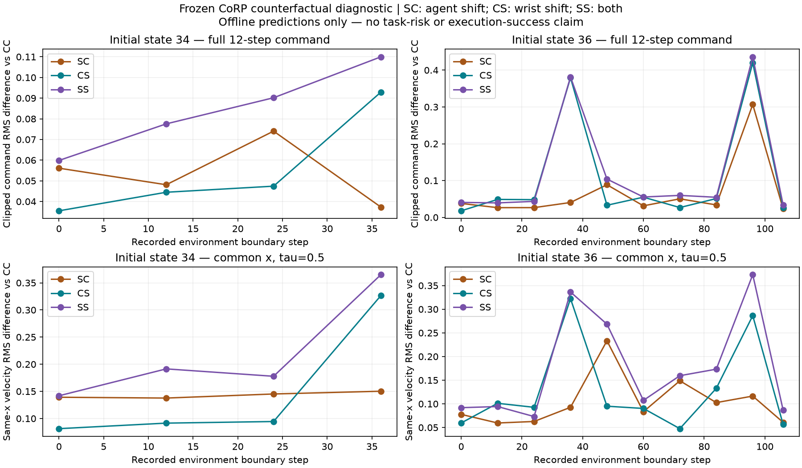

# 反事实策略一致性诊断与 Source 来源复核

## 结论

P0 来源审计通过：fit_smoke/state0 和 val_smoke/state18 是正式完整采集分组，V1 无需剔除或重训。新增跨 shard 指纹检查，缺失/混用来源在 observer loader 中失败；新拟合流程也会校验 Fit/Validation collection signature。原 V1 模型、配置、报告和 STOP_V1 保持不变。

零训练反事实推理显示：在相同当前 proprio、语言、视觉对应状态和随机输入下，仅替换光照条件即可改变 CoRP 的 Resampler 表征、same-x velocity 和完整动作命令。两个视角都有影响。该结果仅支持视觉扰动可以传递到策略输出，**不支持输出变化有害、预测未来失败或可安全适配**。

## 1. 来源和回归修复

- 全部 20 条 Source 元数据的 27 个共同协议字段一致，包括 collector/契约/共享推理代码、checkpoint、split、源文件、upstream、渲染器、精度和库版本；逐条 NPZ 与 V1 留存输入 hash 对上。
- state0：上限220步，实际88步成功，7完整+1部分chunk；state18：93步成功，7完整+1部分。smoke 名称仅表示先验收采集器再扩大分组，不是短跑或非正式协议。
- 来源审计不使用分组名称猜测合法性；collector 与指纹对应。基于持久化证据，不能替代未记录外部行为的审计。
- 新 loader 在打开数组前检查公共 signature；同角色跨 shard 一致，未来新拟合/评价也要求跨 Fit/Validation 一致。缺失字段不能默认为通过。
- 不绕过原 V1 evaluate 的代码漂移保护。历史模型应使用历史提交复现；本轮单独以强化 loader+原冻结模型重算，最大指标差5.56e-16，无重新拟合或修改判据。

## 2. 本轮实验对象

- 现有配对记录：state34 的0/12/24/36，state36 的0/12/24/36/48/60/72/84/96/106，共14个边界、2个独立初始状态、1个采集seed。state36 pilot 与 terminal 重复前缀剔除重复计数。
- 输入仍是 Clean 命令驱动、配对 measured-state 一致的历史回放；不是自然 Lighting 策略新轨迹。本次在服务器 RTX3090 上只执行冻结 CoRP 推理，没有创建环境、执行新动作或采集新seed。
- 对每个边界使用**当前 state8**，不是初始锚点。12/14个边界的当前 state8 已不同于初始锚点。语言和当前 proprio 在四种视觉输入间相同。
- CC：两路Clean；SC：仅agentview换Lighting；CS：仅腕部换Lighting；SS：两路Lighting。混合视角仅作离线归因控制。
- same-x 探针固定保存的 x_probe、tau=0.5、位置k=0；完整动作另固定一个 z0（探针seed20261122，不是新rollout seed），通过官方 policy.predict。完整积分中间x允许随条件不同，不冒充same-x。
- 观测量是**语言条件 Resampler输出**，每路48×768；不是DINO原始patch dynamics。没有加载/优化V1观测器，不是V1的B/C。

## 3. 双视角归因结果

以下均为同一初始状态内各观测边界的算术平均。包含记录末端的离线预测；未将末端预测当作执行动作。动作差是裁剪后12×7控制命令RMS，不是位姿误差、毫米距离、任务风险或成功率。

| 状态 | 视觉条件 vs CC | same-x velocity RMS | clipped command RMS | XYZ命令L2均值 | 夹爪命令绝对差均值 |
|---|---|---|---|---|---|
| 34 | SC | 0.14306 | 0.05389 | 0.13237 | 0.00024 |
| 34 | CS | 0.14842 | 0.05507 | 0.13934 | 0.00023 |
| 34 | SS | 0.21901 | 0.08439 | 0.20856 | 0.00031 |
| 36 | SC | 0.10380 | 0.06652 | 0.09065 | 0.03335 |
| 36 | CS | 0.12842 | 0.11063 | 0.09464 | 0.11367 |
| 36 | SS | 0.17639 | 0.12488 | 0.12729 | 0.11647 |

先状态内平均、再两个初始状态等权后，完整命令RMS：仅主视角0.06020、仅腕部0.08285、双视角0.10463。两状态样本太少，不能将这个排序推广成视角优劣或wrist-only方案。



### 排除记录末端的敏感性汇总

| 状态 | SC command RMS | CS command RMS | SS command RMS |
|---|---|---|---|
| 34 | 0.05942 | 0.04245 | 0.07586 |
| 36 | 0.07133 | 0.11995 | 0.13498 |

这些仍是未执行的完整12步反事实命令。state36第96步之后原回放只执行10步，最后两个预测位置不能冒充实际执行样本。第106步已任务成功，第34状态的第36步是采集截止；两者均标记 recording_end，success/terminated/truncated/done 原始标记另行保留。

### 非线性与命令分量

- SS−SC−CS+CC 的裁剪后命令交互项RMS，state34平均0.01253，state36平均0.03552：两路影响不能简单线性相加。
- state36第36/96步边界SS命令RMS分别0.38159/0.43611，夹爪绝对差均值约0.500/0.664。较大差异含部分动作位置的夹爪命令变化，不能统一解释为XYZ定位偏差。
- 这些差异来自固定探针z0下的潜在计划，与当时实际记录动作所用z0不同；另有保存z0复现检查，但本轮没有执行这些反事实计划。因此不判断哪条计划更正确。

## 4. 状态可区分性：并列检查而不过度命名

以下对比两个不同初始状态在共同边界的 pooled Resampler距离；两侧各自Clean/Shift对应同物理状态，但跨初始状态的执行历史不同。

| 边界 | 共同过去动作？ | agent Clean距离 | agent Shift/Clean | wrist Clean距离 | wrist Shift/Clean |
|---|---|---|---|---|---|
| 0 | 空历史 | 14.243 | 0.991 | 6.800 | 1.412 |
| 12 | 不同 | 14.079 | 0.954 | 4.816 | 0.996 |
| 24 | 不同 | 18.744 | 0.835 | 3.819 | 1.097 |
| 36 | 不同 | 13.834 | 1.476 | 14.887 | 1.329 |

距离没有统一收缩为零，有时缩小、有时扩大；数值非零不证明保留了所有任务信息，更不等于物理状态分类正确。状态8也不是完整物体/接触状态标签。

**未完成的实验是不同物理状态执行相同动作序列后的物理未来可区分性。** 现有数据在12/24/36步之前的跨状态动作历史均不同，没有这类反事实未来；本轮不伪造标签或补做未经设计的新rollout。固定相同flow x和z0只控制模型探针，不能替代相同物理动作历史。

本轮保留跨状态距离与同轨迹不同边界的全部距离，但不称为ACPC的IR/SR，不声称证明未坍缩。常量表征测试会输出零分离、比值未定义，不能被判为完美稳健。

## 5. 正确性与证据

- 28项服务器测试通过：来源指纹缺失/不一致拒绝、当前proprio读取、全维裁剪、常量分离、same-z0不等于same-x、V1原有隔离和数值测试等。
- 56组官方predict与显式Euler检查最大误差0；14次固定probe重复误差0；CC/SS重提token与保存token最大差0；单视角切换另一视角token差0。
- 12个存在后续记录动作的边界，用当时保存z0重算CC，与保存actions_planned最大差0。
- 模型全部state_dict参数/缓冲区运行前后hash相同。checkpoint和输入文件hash核验通过。
- 本地重新打开输出NPZ和原始配对数据，重算378项命令/velocity指标最大差0，当前state8与保存输入一致。
- 修正“记录末端”元数据命名后重跑相同离线推理，226个输出数组最大差0，原run仍留存；没有调参、择优或新增数据。

## 6. 相关研究核对

本轮查阅ACPC arXiv:2608.12939v1正文§3和限制、PhyLatent摘要、TTA-VLA作者页。借鉴之处是同时观察扰动敏感性和状态分离，且把一致性与预测准确性区分。CoRP不是ACPC中的潜在世界模型，本轮没有相同动作条件下的多步世界状态预测，不能继承其理论界限。详细原始来源与适用范围见 `COUNTERFACTUAL_RELATED_WORK_NOTES.md`。

## 7. 保留与暂停

- V1继续STOP_V1，原4.78%/21.51%及其边界不变；没有提高PCA rank、改5%门槛或挑选腕部进入B/C。
- 已有机制证据：当前状态匹配时，光照变化传递到了冻结策略输出；两路视觉都参与响应。
- 仍缺：哪些输出变化损害任务、自然Lighting下未来风险事件、最后可恢复时间与有效提前量、任何Clean保持或TTA收益。
- 暂不训练风险分类器、Adapter、在线EMA或DiT更新。不把本报告中的命令差直接作为风险分数。

## 产物与复现

- 配置/协议提交：`f07fee6`；主实现提交：`e66d99d`；后续仅增强来源跨角色核验及记录末端命名。
- 本目录 `docs/data/counterfactual_task_consistency/` 保存来源审计、原始报告、逐边界CSV、图、测试和复算证据。大输出数组保留在服务器/本地副本，不用Git传输。
- 服务器：`/hy-tmp/patch-diag/runs/counterfactual_task_consistency/inference_v2/`。
- 本地：`/Users/wentiliangkaihua/Documents/ChatGPT/专利论文/remote_artifacts/counterfactual_task_consistency/inference_v2/`。

```bash
OPENBLAS_NUM_THREADS=1 OMP_NUM_THREADS=1 MKL_NUM_THREADS=1 PYTHONPATH=/hy-tmp/patch-diag:/hy-tmp/patch-diag/repos/CoRP:/hy-tmp/patch-diag/repos/CoRP/scripts python scripts/counterfactual_task_consistency.py --paired-root runs/interaction_replay --checkpoint repos/CoRP/checkpoints/corp_libero.pt --config experiments/counterfactual_task_consistency_v1.json --out runs/counterfactual_task_consistency/NEW_RUN
python scripts/audit_source_provenance.py --root runs/source_interactions/20261121 --split docs/data/tta_split_libero_spatial_perturbation.json --out runs/counterfactual_task_consistency/NEW_SOURCE_AUDIT.json
```

本报告是两状态机制诊断。只有在预注册扩展中补齐反事实物理动作条件、风险事件和时序证据，才能继续讨论任务相关的信任判据；当前不宣称专利创新已验证。
