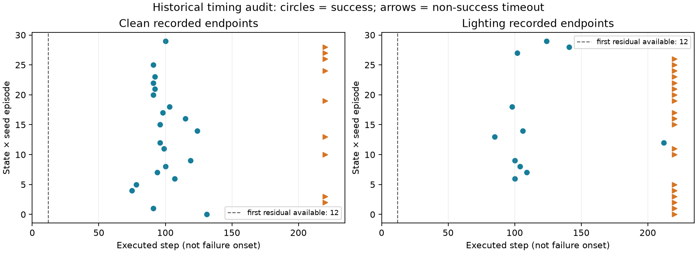

# 历史失败时间审计（零 GPU）

2026-11-21。只读取已有 target-dev 日志；无新 rollout、无 GPU、无模型训练。

## 审计结果

| 当前 frozen 基线 | 成功数 | 成功结束步数：最小 / 中位数 / 最大 | 未成功数 | 未成功结束步数 |
|---|---:|---|---:|---|
| Clean | 21/30 | 75 / 96 / 131 | 9 | 全部 220 |
| Lighting 2292 | 11/30 | 85 / 104 / 212 | 19 | 全部 220 |

两域都没有在第一动作块内结束的 episode。但这只说明终局记录晚于第 12 步，**不说明首次危险或不可恢复点晚于第 12 步**。



横轴是 episode 结束步数，不是风险首次发生时间。圆点为成功，箭头为未成功的截断记录。每域 10 个初始状态、3 个重复 seed，不能当成 30 个独立状态。

## 当前日志能回答与不能回答的字段

- 能回答：每个 state/seed 的成败、实际结束步数、完整/部分 chunk 数、结束前名义观测边界数量。
- 不能回答：当前基线每条轨迹首次任务风险、最后可恢复时刻、失败后有效 replan 机会。
- `first_action_deviation_step`、`first_task_risk_step`、`effective_recovery_opportunities` 明确保留为空，不能用 220 填充。
- H=E=12，因此第一个 transition 残差最早在第 12 步之后可用；对步骤 s 的提前机会只计严格小于 s 的边界。例如 s=12 时没有提前机会，s=13 时才有边界 12。
- 对 220 步截断，12、24、…、216 共 18 个名义观测边界。它们不等于 18 次有恢复价值的机会；最后一个边界之后还只剩 4 步预算。

## 较早逐步日志：行为分歧不等于风险

`failure_trajectories2.json` 保存了 5 条 frozen 轨迹：Clean 36/37，以及 Shift 37/43/45。其余为 transform 干预，未混入自然 frozen 分析。

只有 state37 同时有 Clean/Shift frozen 的完整逐步数据；两者最终都成功。在当前 OSC 控制尺度的解释假设下，XYZ 命令差超过 1、5、10 mm 的首次时间都在第 1 步；夹爪命令差超过 0.5 在第 50 步。这些是描述性阈值扫描，不是已验证任务风险标签。

这个例子说明：不能把第一次命令分歧直接标为任务危险；即使第一块有明显分歧，也不能认定已经不可恢复。

这些旧轨迹缺少持久化的 seed / renderer / checkpoint / controller 指纹，且两域独立执行后物理状态会分离。因此不与当前 30 组基线混合，不用于总体提前量估计。

## Gate 1：7/3/3 的解释边界

历史 13 个 Clean 成功而 Shift 失败的核心样本中：Clean 续跑成功而 Shift 续跑失败 7 个；反向 3 个；两者均失败 3 个。对应初始观测点为执行完第 12 步。

必须同时保留两项限制：

1. 原基线最大 220 步，Gate 1 续跑最大 300 步，不能直接比较成败率。
2. 三个 Shift 续跑成功的终点为 **90、127、113**，都早于 220，但原基线对应样本失败。这种跨运行不一致不能仅用放宽截止解释。未完成对应协议复现审计前，不能把它当成有因果保证的恢复证据。

Gate 1 没有扫描最后可恢复时刻，更没有部署可用的恢复动作验证。`7/13` 不构成可干预比例、物理提前量下界或风险检测上限。

## 决策

已存在名义时间预算，足以支持继续开展源域交互建模；但**有效风险提前量仍未知**。本轮不通过额外 GPU 实验补造风险标签，也不将最终失败传播给所有 chunk。

下一轮若要验证任务风险，需要在自然 Lighting 轨迹上预先定义事件和未来窗口 `(t,t+K]`，时间 t 必须是下一观测已到达的残差可用时刻。不可恢复性需要另行的续跑/干预实验，不能由当前计时表推出。

证据：

- `scripts/audit_failure_timing.py`：CPU-only 可复现脚本。
- `docs/data/failure_timing_20261121/report.json`：源文件 SHA256、逐 episode 数据、Gate 1 分类、旧轨迹事件和缺失字段。
- `docs/data/failure_timing_20261121/episodes.csv`：可复核的平面表。
- `tests/test_source_interactions.py`：严格时间边界测试。

完整旧轨迹仍在原工作区/服务器；仓库另保存 `legacy_frozen_excerpt.json`，保留全部 frozen 记录中审计所需的动作、事件和时间字段，并附原文件 SHA256。已验证摘录重算与原始文件所有已报告指标一致。GitHub 检出后可零 GPU 复现：

```bash
python scripts/audit_failure_timing.py --data docs/data --legacy docs/data/failure_timing_20261121/legacy_frozen_excerpt.json --out /tmp/reproduced_timing --plot
```
