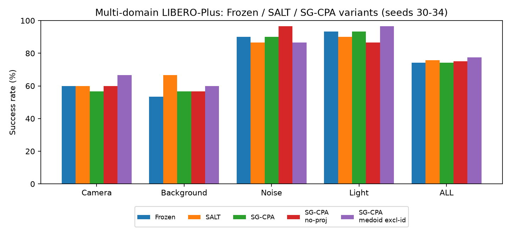
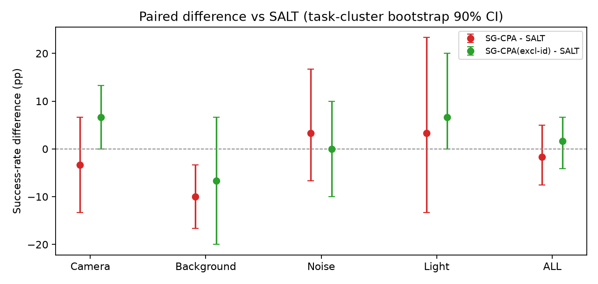

# 工单 4.2 报告：多域 SG-CPA 对比实验（Frozen / SALT / SG-CPA / 消融）

> 执行时间：2026-11-12 01:23–03:43（约 2.3 h，8 路并行）。
> 规模：5 组 × 8 cells × 3 任务 × 5 episodes = **600 episodes**；seeds 30–34（与 Phase 3 的 7–11 不重叠）。
> 全部使用 4.0 最终协议与 4.1 实现（medoid 含 identity、4 视图、直接蒸馏、投影 SGD）。
> 原始数据：`/hy-tmp/validation/p42/<method>/*.jsonl`；分析：`/hy-tmp/validation/p42_analysis/`。
> 表格 CSV：`docs/data/phase4_2_summary.csv`；图：`docs/figures/`。

## 1. 结果总表（成功率）

| 域 | Frozen | SALT | **SG-CPA** | SG-CPA w/o proj | SG-CPA(medoid excl-id)† |
|---|---|---|---|---|---|
| Camera | 60.0% | 60.0% | **56.7%** | 60.0% | 66.7% |
| Background | 53.3% | **66.7%** | 56.7% | 56.7% | 60.0% |
| Noise | 90.0% | 86.7% | **90.0%** | 96.7% | 86.7% |
| Light | 93.3% | 90.0% | **93.3%** | 86.7% | 96.7% |
| **Overall (n=120)** | 74.2% | **75.8%** | **74.2%** | 75.0% | 77.5% |

† medoid-excluding-identity 只作为**机制诊断**（4.0 发现 medoid 75–81% 选中 identity），不是批准的主协议。

## 2. 配对统计（主指标：SG-CPA − SALT）

| 域 | Δ(SG−SALT) | McNemar p | 任务级 bootstrap 90% CI |
|---|---|---|---|
| Camera | −3.3 pp | 1.000 | [−13.3, +6.7] |
| Background | **−10.0 pp** | 0.453 | **[−16.7, −3.3]** |
| Noise | +3.3 pp | 1.000 | [−6.7, +16.7] |
| Light | +3.3 pp | 1.000 | [−13.3, +23.3] |
| **Overall** | **−1.7 pp** | 0.839 | **[−7.5, +5.0]** |

- **没有任何主域上 SG-CPA 显著优于 SALT**；Background 上 SALT 反而更好（CI 不含 0，但 n=30、多重比较，需谨慎）；
- SG-CPA 与 Frozen 几乎完全一致（overall 0.0 pp，p=1.0）→ 适配几乎没有改变策略行为。

### 消融：A 零空间保护是否贡献？

| 对比 | 成功率差 | McNemar p |
|---|---|---|
| SG-CPA − SG-CPA w/o projection | −0.8 pp | 1.000 |

→ 在本次目标/规模下，**没有证据表明 A 零空间投影带来收益**；它与"不投影"表现相同。

### 诊断：medoid 排除 identity

| 域 | Δ(excl−SALT) | p | 90% CI |
|---|---|---|---|
| Camera | +6.7 pp | 0.688 | [0.0, +13.3] |
| Background | −6.7 pp | 0.727 | [−20.0, +6.7] |
| Noise | 0.0 pp | 1.000 | [−10.0, +10.0] |
| Light | +6.7 pp | 0.625 | [0.0, +20.0] |
| Overall | +1.7 pp | 0.839 | [−4.2, +6.7] |

→ 方向性提示"identity 主导"可能是信号弱的原因（Camera/Light 的 CI 下界触 0），但**统计上不显著**，不能作为新结论；
且它不属于批准的主协议，只能作为下一步设计假设。

## 3. 机制诊断（真实 rollout）

| 指标 | SG-CPA | w/o proj | excl-id |
|---|---|---|---|
| updates / episode | 26.5 | 25.7 | 26.0 |
| R_retain（投影保留率） | 0.636 | 1.000 | 0.630 |
| accepted rate | 97.6% | 97.4% | 98.9% |
| backtrack rate | 2.4% | 3.8% | 1.1% |
| **β 最大绝对值（均值）** | **0.0058** | 0.0049 | 0.0044 |
| 单次 replan 适配耗时 | **2.15 s** | 1.65 s | 2.16 s |

关键解释：
- β 边界是 0.15，实际只用到 **0.006（约 4%）** → 适配几乎"没动"；
- 4.0 离线已发现：4 视图 medoid **75–81% 选中 identity**，教师目标多数就是冻结策略自己的动作；
  蒸馏信号（β=0 loss）只有 4e-4–2e-3 → 即使优化完美，动作变化也很小；
- 适配耗时 2.15 s/replan（SALT 约 0.1 s/update），**成本高 20 倍**却没有收益。

## 4. 与预注册判定规则对照

| 预注册规则 | 实际结果 |
|---|---|
| ≥2 主域 Δ(SG−SALT) > 0 且方向一致 | ❌ 仅 Noise/Light 各 +3.3 pp（p=1.0），Camera/Background 为负 |
| 仅 Camera 有效 | ❌ Camera −3.3 pp |
| 全无改善 → 暂停 SG-CPA，不再调参 | ✅ **触发**：overall −1.7 pp，所有主域均无显著改善 |
| 消融差 <2pp → 不能归因 A 零空间 | ✅ 差异 0.8 pp |
| Light/Clean 退化 >5pp | ❌ Light 与 Frozen 持平（93.3%） |

**结论（按预注册规则）：暂停 SG-CPA 主方法实验，不调参、不扩样本。**

## 5. 我们学到了什么（诚实结论）

1. **"medoid 含 identity" 协议在机制上几乎退化为 no-op**：identity 是 3 个轻度增强的中心，75–81% 情况下它就是 medoid；
   这解释了 SG-CPA ≈ Frozen 的结果，也解释了 β 只走到 0.006。
2. **A 零空间保护在当前信号强度下没有可测收益**（vs 不投影：−0.8 pp，ns）；
   没有证据支持"保护 A 方向能带来成功率提升"这一主张。
3. **SALT（always-on port）在本任务集上也没有超过 Frozen**（75.8% vs 74.2%，ns），与 Phase 3 的结论一致；
   这提示这些扰动下的"测试时自监督"本身收益有限，不是单靠换目标函数就能解决。
4. **诊断变体（medoid excl-id）方向性略好**（overall +1.7 pp；Camera +6.7、Light +6.7，CI 下界 0），
   但样本不足以支撑结论，只能作为下一步假设。

## 6. 局限（必须写进任何后续引用）

- 每域仅 **3 任务 × 5 episodes = 30**，任务级 cluster bootstrap 已考虑任务相关性，但统计功效有限；
- 多重比较未做校正（5 组 × 4 域）；
- 评测扰动从 episode 开始即静态存在，而 SALT 原论文主要针对执行中出现的视觉变化；这里是 **always-on port**，不是完整复现；
- medoid/mean 的"正确性"没有专家动作参照，D_view 只反映一致性；
- 未测试真实部署时延（replan 2.15 s 是离线 GPU 实测）；
- 未测其他 clean 任务集（Light 作为高基线对照）。

## 7. 复现与交付

- 代码 commit：见本次提交；
- 运行入口：`scripts/salt_eval.py --mode {frozen,salt,sg_cpa}`（sg_cpa 支持 `--sgcpa-no-projection`、`--sgcpa-medoid-exclude-identity`）；
- 分析：`scripts/analyse_phase4_2.py`、绘图：`scripts/plot_phase4_2.py`；
- 数据：`/hy-tmp/validation/p42/`（5 组各 120 episodes）；
- 图：`docs/figures/sr_by_domain.png`、`docs/figures/delta_vs_salt.png`；
- 表：`docs/data/phase4_2_summary.csv`。

## 8. 建议的下一步（需你决定，不自动执行）

1. **停止 SG-CPA（推荐）**：按预注册规则，当前形式没有收益；保留为负结果与方法学贡献；
2. 若继续：只做一个最小、可证伪的修改——**medoid 排除 identity**（或 anchored mean）——先离线验证信号强度，
   再小规模复跑；但这属于**新协议**，必须单独审批，不能在本次结果上继续调参；
3. 不再在"4 视图 + medoid 含 identity + A 投影"上叠加任何模块。
