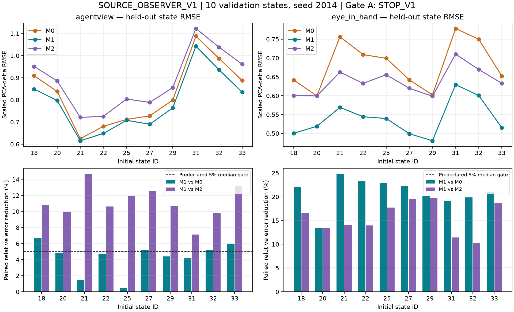

# SOURCE_OBSERVER_V1 实验报告

## 决策：STOP_V1；存在正向预测证据，尚未达到整体继续门槛

本轮只运行关口 A。M1 在两个视角的全部 10 个 Validation 状态上均优于 M0 和 M2。腕部视角通过预定全部条件；主视角相对 M0 的逐状态中位增益为 **4.7847%**，低于首次评分前冻结的 **5%** 项目门槛，其他条件均通过。因此维持 STOP_V1，不因结果接近门槛而改阈值，不自动选择腕部进入 B/C。

这个 5% 是预先选择的工程决策标准，不是文献推导的科学分界。结果不能写成“观测器完全无效”或“没有视觉增量”：这里已有单任务、单 seed、10 个未参与拟合状态上的正向预测证据。它仍不是风险识别或跨域鲁棒性证据。

## 冻结设计、数据与执行

- 配置与判据先提交：`bbbaa85`；实现提交：`264fcd9`。随后才进行本轮真实 Source 数据的首次拟合和 Validation 评分。已有数据结构、长度和成败分布并非盲法未知。
- Source Fit：10 状态、101 个完整 chunk；Source Validation：10 个不同状态、74 个完整 chunk；8/10 个部分 chunk 分别排除。seed=2014、H=E=12，不增加采集。该隔离针对本观测器，冻结 CoRP 预训练状态重叠未独立核查。
- 两视角分别 mean-pool 48 个 token 为 768 维，再用 Fit 独有、状态等权的 8 维 PCA；实际动作压缩为三个连续四步均值，共 21 维。
- M0：state8+action21（29 维）；M1：PCA8+state8+action21（37 维）；M2：PCA8（8 维）。输出均为 8 维 PCA delta。参数量分别 240、304、72（含截距）。
- Ridge alpha=1，样本权重之和为 1，每个初始状态总权重相等；标准化、PCA、目标残差尺度全在 Fit 拟合。没有搜索 rank/alpha，也没有按结果重训。
- 模型在服务器 CPU 使用真实 CoRP 采集数据拟合；没有重跑 GPU 策略，没有训练 Adapter 或修改 CoRP。拟合与评分是两个进程，模型先落盘才读取 Validation。
- 未加载受控 Lighting、自然 Lighting 或 target-test；未计算风险 AUROC、报警阈值或有效提前量。

## 主结果

误差为 Fit 逐维 delta 标准差缩放后的 PCA-delta RMSE。表中误差是 10 个状态的中位数，增益是“逐状态误差比”的中位数，两者不能互相直接相除替代。

| 视角 | M0 RMSE | M1 RMSE | M2 RMSE | M1 vs M0 中位增益 | M1 vs M2 中位增益 | 逐状态胜出 |
|---|---|---|---|---|---|---|
| 主视角 | 0.8187 | 0.7808 | 0.8706 | 4.78% | 10.76% | 两个比较均 10/10 |
| 腕部视角 | 0.6757 | 0.5293 | 0.6329 | 21.51% | 15.37% | 两个比较均 10/10 |

平均逐状态增益的 95% bootstrap 区间（以初始状态重采样，不以 chunk 重采样）：

| 视角 | 比较 | 平均增益 | 状态 bootstrap CI95 |
|---|---|---|---|
| 主视角 | M1 vs M0 | 4.32% | 3.09% / 5.32% |
| 主视角 | M1 vs M2 | 11.13% | 9.86% / 12.36% |
| 腕部视角 | M1 vs M0 | 20.88% | 18.84% / 22.52% |
| 腕部视角 | M1 vs M2 | 15.54% | 13.59% / 17.45% |

区间仅为十状态探索性描述，不提供总体置信、安全或跨 seed / 任务 / 域保证。总体 gate 要求两视角全部条件通过。



## 主视角：全部 Validation 状态

| state | 完整 chunk | M0 | M1 | M2 | M1 vs M0 | M1 vs M2 |
|---|---|---|---|---|---|---|
| 18 | 7 | 0.9096 | 0.8487 | 0.9515 | 6.69% | 10.80% |
| 20 | 9 | 0.8381 | 0.7975 | 0.8854 | 4.85% | 9.93% |
| 21 | 7 | 0.6248 | 0.6155 | 0.7210 | 1.50% | 14.64% |
| 22 | 7 | 0.6807 | 0.6486 | 0.7258 | 4.72% | 10.63% |
| 25 | 7 | 0.7117 | 0.7080 | 0.8042 | 0.52% | 11.96% |
| 27 | 7 | 0.7278 | 0.6899 | 0.7886 | 5.20% | 12.51% |
| 29 | 7 | 0.7993 | 0.7640 | 0.8557 | 4.42% | 10.72% |
| 31 | 8 | 1.0879 | 1.0427 | 1.1226 | 4.16% | 7.12% |
| 32 | 8 | 0.9877 | 0.9364 | 1.0383 | 5.19% | 9.81% |
| 33 | 7 | 0.8876 | 0.8349 | 0.9616 | 5.94% | 13.17% |

## 腕部视角：全部 Validation 状态

| state | 完整 chunk | M0 | M1 | M2 | M1 vs M0 | M1 vs M2 |
|---|---|---|---|---|---|---|
| 18 | 7 | 0.6417 | 0.5004 | 0.6002 | 22.01% | 16.63% |
| 20 | 9 | 0.5997 | 0.5190 | 0.5995 | 13.47% | 13.44% |
| 21 | 7 | 0.7564 | 0.5692 | 0.6627 | 24.74% | 14.11% |
| 22 | 7 | 0.7091 | 0.5443 | 0.6328 | 23.24% | 13.99% |
| 25 | 7 | 0.6993 | 0.5396 | 0.6558 | 22.83% | 17.71% |
| 27 | 7 | 0.6421 | 0.4992 | 0.6198 | 22.26% | 19.46% |
| 29 | 7 | 0.6021 | 0.4806 | 0.5986 | 20.18% | 19.72% |
| 31 | 8 | 0.7782 | 0.6294 | 0.7104 | 19.13% | 11.41% |
| 32 | 8 | 0.7499 | 0.6007 | 0.6697 | 19.89% | 10.30% |
| 33 | 7 | 0.6521 | 0.5151 | 0.6330 | 21.01% | 18.63% |

## 两个非学习对照与共享当前 z 的检查

零变化对照预测 delta=0；平均下一状态对照预测 Fit 的下一状态均值减当前状态。后者用于检查目标中共享当前 z 是否只产生回归均值的收益。输入当前 z 本身是合法条件，不等于数据泄漏。

| 视角 | M1 vs 零变化中位增益 | M1 vs 平均下一状态中位增益 |
|---|---|---|
| 主视角 | 20.91% | 29.63% |
| 腕部视角 | 46.90% | 34.86% |

两对照在两个视角均是 10/10 状态被 M1 超过。这支持结果不只是上述两个简单平凡预测，但不能排除所有隐含任务阶段或其他替代解释。

## 轨迹长度、阶段和动作输入诊断

| 视角 | 共同早期 end≤72：vs M0 / M2 | 排除末尾24步：vs M0 / M2 | 固定模型动作错配：误差中位增幅 |
|---|---|---|---|
| 主视角 | 5.38% / 12.28% | 5.60% / 11.86% | 20.24% |
| 腕部视角 | 22.36% / 16.54% | 21.62% / 15.58% | 36.90% |

- 两个预定时间子集上，两个视角的 M1 均在 10/10 状态优于两个学习对照；没有观察到增益仅来自最后几个 chunk。没有因此替换主指标或修改 gate。
- M1 误差与结束步数的逐状态 Spearman 中位数：主视角 +0.661，腕部 +0.357；与目标变化范数分别约 +0.786 / +0.857。残差仍依赖时间段和变化幅度。elapsed 与 remaining 在每条轨迹内线性相反，不是两份独立证据。
- 这些是时间段诊断，不是拥有物理标签的真实任务阶段控制，不能据此彻底排除阶段混杂。
- M1 vs M2 同时增加 state8 与动作，不能将全部增益归于动作。固定模型的状态内动作块循环错配，使两个视角全部 10 个状态误差增加，说明预测依赖动作条件；但错配可能超出输入支持，不能解释成动作的因果效应。
- M1 中至少一维超过 Fit 标准化 ±3 的 Validation chunk 比例：主视角 6/74，腕部 3/74；最大绝对标准化输入约 4.129。未据此剔除任何 Validation 样本。
- Fit 失败状态 4/17 的 M1 训练 RMSE：主视角 0.8966/0.6835，腕部 0.5999/0.5859；Fit 成功状态中位数分别 0.7885/0.6219。失败轨迹残差并非一致偏高；这是训练分布描述，不能作风险区分证据。Validation 全部成功，无法在该数据上验证风险排序。

## 压缩损失与原 768 维池化特征误差

| 视角 | Fit PCA 边界方差覆盖 | Validation delta 能量覆盖（状态中位） | 768维 M1 vs M0 中位增益 | 768维 M1 vs M2 中位增益 |
|---|---|---|---|---|
| 主视角 | 73.30% | 48.20% | 1.66% | 5.50% |
| 腕部视角 | 87.01% | 84.92% | 11.67% | 14.03% |

主视角 8 维投影只覆盖约一半 Validation 变化能量，不能把低维 RMSE 的改善当成对完整视觉变化的同幅改善。上述 768 维仍是每视角池化后的表示，不是完整 48×768 tokens，更不是未来 RGB 图像。未根据这些结果增大 rank 或改变表示。

## 方向误差（预定辅助指标）

| 视角 | M0：1-cos | M1：1-cos | M2：1-cos | 各模型最小状态有效比例 |
|---|---|---|---|---|
| 主视角 | 0.4762 | 0.4179 | 0.5255 | 100.00% |
| 腕部视角 | 0.2023 | 0.1054 | 0.1129 | 100.00% |

表中是逐状态平均方向误差再取状态中位数；越低越好。条件为真实缩放变化范数>0.1、预测范数>1e-12，当前 Validation 全部满足。方向误差在同一缩放 PCA 空间计算，不是物理动作姿态误差，也未用来替换预定 RMSE gate。

## 验收与复现

- 19 项服务器测试通过，包括 weighted ridge 与声明目标的闭式解一致、加权 PCA 与等权参考实现一致、禁止 Validation 拟合、Fit loader 不读取 Validation、部分 chunk 末端排除、模型不被预测改写、时间/成败元信息不进入拟合。
- 本地对同一冻结模型和本地原始 Validation NPZ 重算全部 200 项状态指标，与服务器最大差 5.56e-16；模型评分前后 SHA256 不变。
- 模型 hash：`8d79ebfb0ae25bc03297e35d42cd427361d2bbd9fd94284fa4b62097af5db04b`。完整参数及预处理在 `docs/data/source_observer_v1/model.npz`，元信息在 `model.json`。
- `validation_report.json` 包含全部关口条目及失败原因；`state_metrics.csv`、`fit_chunks.csv`、`validation_chunks.csv` 提供逐状态和逐 chunk 审核数据；`server_tests.txt` 和 `local_reproduction.json` 是验证证据。
- 服务器产物：`/hy-tmp/patch-diag/runs/source_observer_v1/`；本地原始副本：`/Users/wentiliangkaihua/Documents/ChatGPT/专利论文/remote_artifacts/source_observer_v1/`。

## 文献与结论边界

- scikit-learn 官方 Common pitfalls / Ridge 文档支持训练/验证隔离以及明确正则目标；本轮另外用数值测试核对 sum(w)=1 的目标，不把未经说明的 alpha 数字互相比较。
- PhyLatent 的物理不变性问题属于下一关口：本次正常域预测表现不回答纯光照是否导致假报警。
- Selective Classification Under Distribution Shifts 关注错误识别与分布偏移的区别；本轮没有风险事件标签，不能从这些 RMSE 转写出 Type C 风险检测结论。
- 5% 门槛、8 维 PCA 和 alpha=1 是本轮事先选定的项目设定，不是这些论文证明的最优选择。

原始来源：
`https://scikit-learn.org/stable/common_pitfalls.html`
`https://scikit-learn.org/stable/modules/generated/sklearn.linear_model.Ridge.html`
`https://arxiv.org/abs/2608.05720`
`https://arxiv.org/html/2405.05160v2`

## 本轮最终状态

源域观测预测：腕部达到本次继续门槛，主视角存在稳定但略低于门槛的增量；整体 STOP_V1。纯外观鲁棒性、自然 Lighting 风险预测、有效提前量及安全适配仍未验证。本轮保持冻结配置和模型，提交报告供复核，不启动 B/C，不改变 seed，也不改 Adapter。

## 复现入口

在服务器 `/hy-tmp/patch-diag` 使用已记录版本的 Python 环境，固定单线程 BLAS；训练与评分分开执行，输出目录必须不存在。

```bash
OPENBLAS_NUM_THREADS=1 OMP_NUM_THREADS=1 MKL_NUM_THREADS=1 python scripts/source_observer_v1.py fit --source-root runs/source_interactions/20261121 --split docs/data/tta_split_libero_spatial_perturbation.json --config experiments/source_observer_v1.json --out runs/source_observer_v1/NEW_FIT
OPENBLAS_NUM_THREADS=1 OMP_NUM_THREADS=1 MKL_NUM_THREADS=1 python scripts/source_observer_v1.py evaluate --source-root runs/source_interactions/20261121 --split docs/data/tta_split_libero_spatial_perturbation.json --config experiments/source_observer_v1.json --model-dir runs/source_observer_v1/NEW_FIT --out runs/source_observer_v1/NEW_VALIDATION
python -m unittest tests.test_source_observer tests.test_source_interactions tests.test_interaction_records tests.test_b3_fold_isolation -v
```

上述入口用于复现，不能通过反复运行并改参挑选更好结果。当前 Validation 已被用于本轮评价；未来若改变表示、正则或关口，不得继续将它宣称为未查看过的独立验证集。
